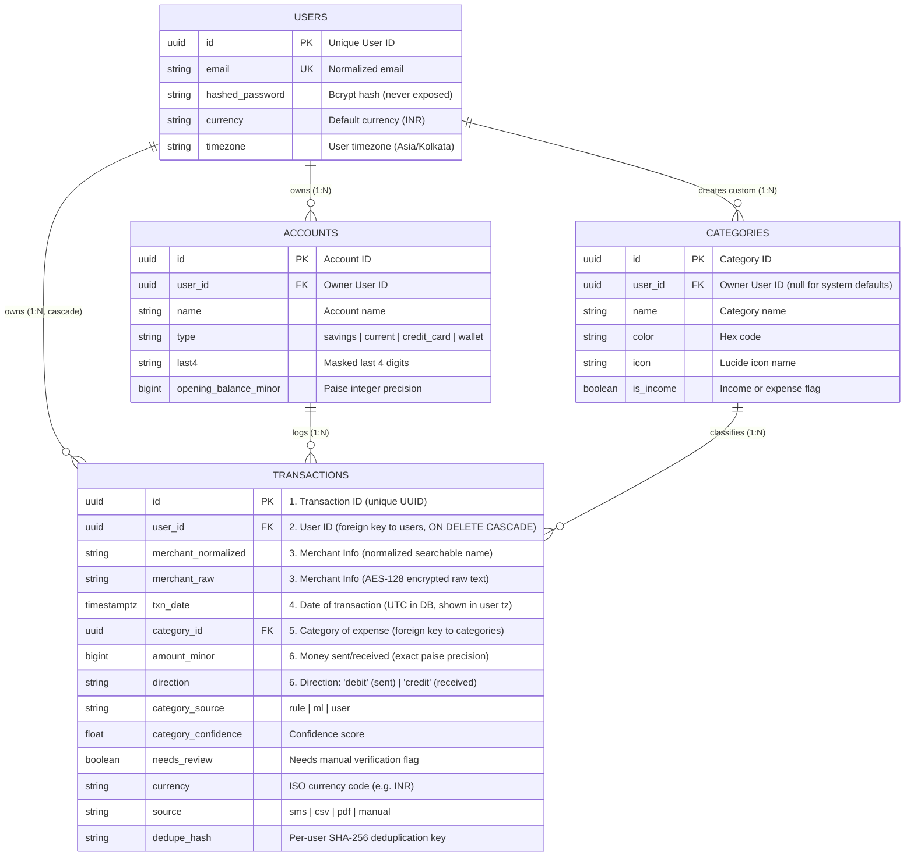

# AI Personal Finance Manager

A production-quality personal finance management web application designed for modern Indian and global banking (UPI, NEFT, IMPS, cards, wallets, cash) with multi-format ingestion (SMS, CSV, XLSX, text-based PDF), rule & AI categorization, predictive analytics, and personalized savings insights.

---

## Architecture & Technology Stack

- **Frontend**: Next.js 14 (App Router) + TypeScript + Tailwind CSS + Lucide Icons + Recharts + React Hook Form + Zod + TanStack Query.
- **Backend**: Python FastAPI + Pydantic v2 + SQLAlchemy 2.0 (asyncpg / aiosqlite) + Alembic migrations.
- **Database**: PostgreSQL (with minor-unit paise BIGINT monetary precision, UTC timestamps, user-scoped queries, and deduplication hashes).
- **Background Processing & Cache**: Redis + FastAPI background tasks.
- **Auth**: JWT access tokens (short-lived) + refresh tokens in secure `httpOnly` cookies, bcrypt password hashing.

---

## Frontend Pages & User Flows

1. **Authentication (`/login`, `/register`)**:
   - Form validation via React Hook Form + Zod.
   - User registration with default currency (`INR`) and timezone (`Asia/Kolkata`).
   - Dual-token session: JWT access token + secure `httpOnly` refresh cookie with automatic silent renewal on 401.
   - Clean alert banners for validation errors and backend status codes.

2. **Dashboard Overview (`/dashboard`)**:
   - Total Net Worth calculation across all linked accounts formatted in minor units (`₹` / `paise`).
   - Active accounts and categories counters.
   - Linked bank accounts overview with live computed balances (`opening_balance_minor + credits - debits`).
   - **Review Categorization Suggestions Card**: Alert card surfacing transactions flagged for manual review due to ambiguous merchant names or low classification confidence.
   - Quick action shortcuts (Add Account, View Categories, Statement Import).

3. **Transaction Vault & History (`/transactions`)**:
   - Paginated history sorted by date descending with filters for date range, category, direction, search text, min/max amount, and "Needs Review".
   - Shows colored category badges with assignment source badges: *"Rule"*, *"Suggested by model (XX%)"*, or *"You"*.
   - Detail modal showing full record, account name, raw text, and category editor with *"Always use this category for this merchant"* checkbox.
   - One-click trigger to re-run categorization on all transactions after rule updates.

4. **Financial Accounts Management (`/accounts`)**:
   - Full CRUD operations connected directly to `GET /api/v1/accounts`, `POST /api/v1/accounts`, `PATCH /api/v1/accounts/{id}`, `DELETE /api/v1/accounts/{id}`.
   - Account types: `savings`, `current`, `credit_card`, `wallet`, `cash`.
   - Modals for creating and editing accounts with strict validation (4-digit card masks, integer minor unit conversions).
   - Delete confirmation dialog with balance wipe warnings.

5. **Category Taxonomy (`/categories`)**:
   - Connected directly to `GET /api/v1/categories`, `POST /api/v1/categories`, `DELETE /api/v1/categories/{id}`.
   - Tab filters: *All Categories*, *System Default (Protected)*, *Custom User Categories*.
   - Protection badge & lock icons for default Indian categories.
   - Modal for custom category creation with color picker presets, icon identifier, and income/expense flag.

6. **Statement & SMS Ingestion Portal (`/import`)**:
   - **Standard Security Consent Screen (`<ConsentModal />`)**: Prompts user with Google-style permissions before accessing SMS texts or parsing uploaded files.
   - Interactive 4-in-1 ingestion UI:
     - **Paste SMS**: multi-bank SMS alert parsing for Indian banks (HDFC, SBI, ICICI, Axis, Kotak, UPI) with sample data loader.
     - **CSV Statement Upload**: in-memory parsing with automatic column detection.
     - **PDF Statement Upload**: digital text-based e-statement uploader with `pdfplumber`.
     - **Manual Entry**: single transaction logger for cash/offline expenses.

7. **Spending Analytics & Forecasting (`/analytics`)**:
   - Interactive category spending distribution donut chart using Recharts.
   - Monthly cashflow income vs expenses trend bar chart.
   - Next-month predictive forecast card powered by deterministic statistical exponential smoothing and run-rate blending.
   - Personalized savings suggestions.

8. **Privacy Settings & Data Governance (`/settings`)**:
   - List active and revoked consents with timestamps and grant/revoke actions.
   - Self-service data export (`GET /api/v1/users/me/export`) and complete data erasure with password verification (`DELETE /api/v1/users/me/data`).

---

## Consent & Categorization Architecture

### 1. Standard Security Consent Screen (Promise 1 & 6)
User permission is requested explicitly before analyzing financial messages or parsing statements, modeled after standard Google-style security dialogs and banking apps with zero dark patterns:
- **Multilingual Copy (`frontend/src/lib/consentCopy.ts`)**: Structured text for English, Hindi, and Marathi.
- **Reusable `<ConsentModal />`**:
  - Focus trap, Esc to close, and accessible ARIA attributes (`aria-labelledby`, `aria-describedby`).
  - Clear sections: *What we will access*, *What we use it for*, *What we will NOT do*, and *Your control*.
  - Independent buttons ("Allow" vs "Not now") with nothing pre-checked.
- **Backend Middleware**: All ingestion endpoints (`/imports/sms`, `/imports/csv`, `/imports/pdf`) enforce active tenant consent in the database; unauthorized attempts return `HTTP 403 Forbidden`. Every grant and revocation writes an immutable audit record to `AuditLog`.
- **Privacy Settings**: Self-service toggle to review active consent timestamps or revoke access at any time.

### 2. Expense Separation Pipeline ("How are my expenses separated?")
> *"Our system uses predefined rules and model-based suggestions to sort your transactions into categories. Each transaction is stored with its own ID under your user ID, and we look at its details (merchant, description, amount and date) to decide the category. You can always correct it."*

Transactions are sorted using a transparent, 3-tier precedence pipeline:
1. **Predefined Rules (Priority 1)**:
   - Evaluates the user's personal `MerchantRule` records first.
   - Falls back to built-in keyword and regex rules for common Indian merchants and UPI codes (Swiggy, Zomato, Uber, Ola, Amazon, Flipkart, Bescom, etc.).
   - Sets `category_source = "rule"` with `100%` confidence.
2. **Model-Based Suggestions (Priority 2)**:
   - If no rule matches, a privacy-preserving text model evaluates **minimal non-PII attributes only** (`merchant_normalized`, `description`, `amount`, `direction`).
   - Balances, card numbers, and personal names are stripped prior to classification.
   - If confidence is below `0.6` (e.g. for unseen or ambiguous merchants like "UNKNOWN CORP"), the transaction is marked as `needs_review = True` and assigned to `Uncategorized`.
3. **User Correction Wins (Priority 3)**:
   - When a user corrects or updates a category (`PATCH /api/v1/transactions/{id}`), it immediately locks `category_source = "user"`.
   - Selecting *"Always use this category for this merchant"* creates a tenant-scoped `MerchantRule`, ensuring future statements from that merchant are categorized automatically by the rule without influencing other users.
4. **Needs Review & Re-Categorization**:
   - `GET /api/v1/transactions/needs-review`: Returns user-scoped transactions needing review.
   - `POST /api/v1/transactions/recategorize`: Re-evaluates transactions against newly added or edited rules while preserving user-locked categories.

---

## Structured Transaction Storage & History

User data and transaction records are organized in a relational schema guaranteeing tenant separation, strict referential integrity, and high-performance querying.

### Entity-Relationship Diagram



---

## Multi-User Data Isolation Flow

The backend enforces strict tenant isolation on every protected endpoint across four sequential layers:

```
[ Incoming Request ]
        │
        ▼
1. Authentication  ──▶ Validates JWT bearer token and extracts verified user_id (get_current_user). Never trusts client-supplied user IDs.
        │
        ▼
2. Authorization   ──▶ Confirms resource ownership via get_owned_or_404. Cross-user access returns 404 (not 403 or data) so IDs cannot be probed.
        │
        ▼
3. Database        ──▶ Every query is filtered by user_id = current_user.id. Shared system categories (user_id = null) are strictly read-only.
        │
        ▼
4. Backend         ──▶ Formats and returns only that user's records and aggregate calculations.
```

---

## How Monthly Spending Prediction Works

The prediction engine estimates how much money a user is likely to spend by the **end of the current month**, blending past habits with live spending progress through an explainable, deterministic statistical model:

1. **User Scoping & Timezones**: Only non-deleted debit transactions belonging to the authenticated user are evaluated. Dates are mapped into the user's local timezone (e.g. `Asia/Kolkata`) for accurate calendar month boundaries.
2. **Outlier Filtering**: Before computing historical baselines, anomalous single-transaction spending spikes (amounts exceeding `mean + 3*std`) are filtered out so that unusual one-off purchases do not distort future forecasts.
3. **Weighted Historical Baseline**: A weighted moving average (WMA) of up to the last 6 completed calendar months is computed, giving higher weights to recent months (weights: `1, 2, ..., k`).
4. **Current Run-Rate Projection**: The user's live spending so far is scaled by the fraction of days elapsed: `(spent_so_far / days_elapsed) * days_in_month`.
5. **Dynamic Blending**: Early in the month, the model relies predominantly on the historical baseline; as the month progresses towards the final days, it smoothly shifts weight towards the current run-rate (`alpha = days_elapsed / days_in_month`):
   `blended = (1 - alpha) * baseline + alpha * run_rate`.
6. **Upcoming Recurring Expenses**: Recurring expenses (e.g. rent, subscriptions, EMIs) are automatically detected when consistent amounts appear in at least 2 distinct previous months. If a detected recurring commitment has not yet posted in the current month, the projected remaining amount is adjusted to ensure it is accounted for.
7. **Diminishing Uncertainty Range**: A confidence interval `[lower_bound, upper_bound]` is established using past monthly standard deviation scaled by the days remaining in the month. As the month draws to a close, uncertainty shrinks towards the actual amount spent (`lower <= predicted <= upper`).
8. **Explainable Drivers & Category Budgets**: The model produces plain-English explanations (e.g. pace per day, expected recurring rent, comparison to last month) and flags any category projected to exceed the user's monthly budget limit.

---

## How to Run the Full Stack

### 1. Start the Backend API Server
```powershell
cd backend
.\venv\Scripts\uvicorn app.main:app --reload --port 8000
```
- API Docs: [http://localhost:8000/api/v1/docs](http://localhost:8000/api/v1/docs)

### 2. Start the Next.js Frontend
In a new terminal window:
```powershell
cd frontend
npm.cmd run dev
```
- Web Application: [http://localhost:3000](http://localhost:3000)

### 3. Run Automated Pytest Suite
```powershell
cd backend
.\venv\Scripts\pytest -v tests
```

---

## Admin (Bank Staff) Dashboard & Privacy Rules

The system provides an isolated, read-only **Bank Staff / Admin Dashboard** (`/admin`) designed to provide portfolio analytics, risk alerts, and customer support without compromising our core promise: *"Each customer can only access their own data"*.

### 1. Role-Based Access Control (RBAC)
- **User Roles**: `customer` (default) and `admin`.
- **JWT & `/auth/me`**: Role claims are embedded inside JWT payloads and returned in `/auth/me`.
- **Route Guarding**:
  - Backend: All routes under `/api/v1/admin/*` enforce the `require_admin` dependency. Customers attempting to query admin endpoints receive an immediate `HTTP 403 Forbidden`. Admin routes are rate-limited.
  - Frontend: Customers visiting `/admin/*` are automatically redirected to `/dashboard`. Admins visiting customer routes are routed to `/admin`.
  - Visual Distinction: The admin portal uses a distinct dark slate and indigo theme with a prominent **[Bank Staff / Read-Only]** indicator banner.

### 2. Privacy & Isolation Guarantees for Staff Access
1. **Strict Read-Only Mode**: Admin access is 100% read-only. Bank staff cannot create, edit, or delete customer transactions or accounts, and the application has zero fund-movement or transaction-initiation capabilities.
2. **Explicit Consent or Demo Visibility Only**:
   - Bank staff can view **only** (a) synthetic demo customers (`is_demo=true`), and (b) real customers who have granted an active `"share_with_bank"` consent.
   - Any customer without active consent is completely **invisible** to admin queries, returning `HTTP 404 Not Found` (never 403 or customer metadata) to prevent enumeration probing.
3. **Sensitive Field Masking**:
   - Email addresses are partially masked (`s***t@demo.com`).
   - Account numbers display only the last 4 digits (`****5589`).
   - Password hashes, tokens, or raw SMS/statement text are never exposed.
4. **Immutable Audit Logging**:
   - Every lookup, list view, Customer 360 inspection, status toggle, and CSV export records an entry in `AuditLog` storing the admin ID, customer ID, action, timestamp, and IP address.
5. **Operational Account Status Control**:
   - The only permitted write action is account deactivation/reactivation (`PATCH /admin/customers/{id}/status`), which is logged and immediately blocks deactivated accounts from authenticating.

---

## Demo Data & Logins

An idempotent, production-safe seed script creates 1 Bank Staff Admin and 5 diverse Indian customer personas with 6 months of realistic transactions, budgets, forecasts, and deliberate anomalies for risk testing:

### Running the Seed Script
```powershell
cd backend
.\venv\Scripts\python.exe scripts/seed_demo.py
```
*(Refuses to run in `ENVIRONMENT=production` unless `--force` is passed).*

### Pre-configured Login Accounts
| Role / Persona | Email | Password | Monthly Profile | Deliberate Test Anomaly |
| :--- | :--- | :--- | :--- | :--- |
| **Bank Staff Admin** | `admin@demo.com` | `AdminDemo@123!` | Executive oversight portal | Full access to demo & consented accounts |
| **Student** | `student@demo.com` | `Customer@123!` | Aarav Sharma (~₹15k/mo, pocket money, food, metro, Spotify) | Spending spike: MacBook purchase > 1.5x average |
| **Working Professional** | `professional@demo.com` | `Customer@123!` | Priya Nair (~₹80k/mo, salary, rent, EMI, groceries, SIPs) | Budget overshoot: Celebration dining exceeds budget |
| **Business Owner** | `business@demo.com` | `Customer@123!` | Rajesh Gupta (~₹3.5L/mo, revenue credits, suppliers, GST, bills) | Regular high-volume vendor UPI flows |
| **Freelancer** | `freelancer@demo.com` | `Customer@123!` | Ananya Iyer (~₹60k/mo, irregular wire credits, SaaS tools, WeWork) | Spend > Income anomaly: Monthly deficit cashflow |
| **Family Household** | `family@demo.com` | `Customer@123!` | Vikram Deshmukh (~₹1.8L/mo, dual salary, school fees, utilities) | Category spike: Hospital surgery bill > 50% spend |

> **Tip**: The `/login` page includes a **Quick Demo Logins** 1-click helper panel that autofills any of the accounts above instantly.

---

## Multi-Channel OTP & Email Setup

The authentication and account-linking system uses a unified multi-channel OTP delivery engine supporting **Email** and **SMS**.

### 1. Provider Configuration
Configure providers independently in your `.env` file:
```env
# SMS Provider: console | msg91 | twilio
OTP_SMS_PROVIDER=console

# Email Provider: console | smtp | resend | sendgrid | brevo
OTP_EMAIL_PROVIDER=console
```

> **Security Guardrail**: When `ENVIRONMENT=production`, the application refuses to start if `OTP_EMAIL_PROVIDER=console` or `OTP_SMS_PROVIDER=console`. In production you must provide valid credentials for SMTP or a cloud provider.

---

### 2. Email Provider Options & Quickstarts

#### Option A: Local Development (Console Mode - Default)
No setup required. Codes and security alerts are printed directly to your backend server logs with clear visual formatting:
```text
================================================================
[CONSOLE EMAIL DISPATCH - DEV ONLY]
To:      a***@example.com
Subject: Your FinTrack AI verification code
From:    FinTrack AI <noreply@fintrack.ai>
----------------------------------------------------------------
FinTrack AI Verification Code
------------------------------------
Your one-time verification code is: 492815
Valid for 5 minutes.
================================================================
```

#### Option B: Local Mailpit (Docker Test SMTP)
A Mailpit test server is included in `docker-compose.yml`. It captures all outgoing emails into a local web inbox without sending real mail.
```bash
docker compose up -d mailpit
```
Configure backend `.env`:
```env
OTP_EMAIL_PROVIDER=smtp
SMTP_HOST=localhost
SMTP_PORT=1025
SMTP_USE_TLS=false
EMAIL_FROM_ADDRESS=noreply@fintrack.ai
```
Open Mailpit Web UI at **`http://localhost:8025`** to preview responsive HTML emails and OTP codes in real time.

#### Option C: Gmail SMTP with an App Password
For quick staging or personal testing with real delivery to your inbox:
1. Enable **2-Step Verification** on your Google Account: [myaccount.google.com/security](https://myaccount.google.com/security).
2. Go to **Security → 2-Step Verification → App passwords**.
3. Generate a 16-character password (name it `FinTrack AI`).
4. Update your `.env`:
```env
OTP_EMAIL_PROVIDER=smtp
SMTP_HOST=smtp.gmail.com
SMTP_PORT=587
SMTP_USERNAME=your-gmail@gmail.com
SMTP_PASSWORD=your-16-char-app-password
SMTP_USE_TLS=true
EMAIL_FROM_NAME="FinTrack AI"
EMAIL_FROM_ADDRESS=your-gmail@gmail.com
```

#### Option D: Cloud Email APIs (Resend, SendGrid, Brevo)
- **Resend**:
  ```env
  OTP_EMAIL_PROVIDER=resend
  RESEND_API_KEY=re_123456789...
  EMAIL_FROM_ADDRESS=verify@yourdomain.com
  ```
- **SendGrid**:
  ```env
  OTP_EMAIL_PROVIDER=sendgrid
  SENDGRID_API_KEY=SG.123456789...
  EMAIL_FROM_ADDRESS=verify@yourdomain.com
  ```
- **Brevo (Sendinblue)**:
  ```env
  OTP_EMAIL_PROVIDER=brevo
  BREVO_API_KEY=xkeysib-123456789...
  EMAIL_FROM_ADDRESS=verify@yourdomain.com
  ```

---

### 3. Production Deliverability Best Practices (SPF, DKIM, DMARC)
To guarantee your verification and security alert emails land in user inboxes rather than spam:
1. **SPF (Sender Policy Framework)**: Add a TXT record for your domain authorizing your email service (e.g. `v=spf1 include:sendgrid.net ~all` or `v=spf1 include:resend.com ~all`).
2. **DKIM (DomainKeys Identified Mail)**: Configure the CNAME records provided by your email vendor to cryptographically sign outgoing messages.
3. **DMARC (Domain-based Message Authentication)**: Add a TXT record at `_dmarc.yourdomain.com`:
   ```text
   v=DMARC1; p=quarantine; rua=mailto:dmarc-reports@yourdomain.com; pct=100
   ```
4. **Zero Sensitive Data Principle**: Our email templates never include sensitive account balances, full card numbers, or passwords, preserving customer confidentiality across all email intermediaries.

---

---

## Going Live: Real OTP (SMS & Email) & Real AI Model Guide

FinTrack AI is equipped with real multi-channel OTP delivery and real AI provider adapters with rigorous privacy safeguards.

### 1. Real Multi-Channel OTP (Email + SMS)

#### SMS Providers (`OTP_SMS_PROVIDER`)
Configure real SMS delivery via Twilio or MSG91 in your `.env`:
```env
OTP_SMS_PROVIDER=msg91   # msg91 | twilio | console
MSG91_AUTH_KEY=your_msg91_auth_key
MSG91_SENDER_ID=FNTRCK
MSG91_TEMPLATE_ID=your_dlt_approved_template_id
```
Or for Twilio:
```env
OTP_SMS_PROVIDER=twilio
TWILIO_ACCOUNT_SID=ACXXXXXXXXXXXXXXXXXXXXXXXXXXXXXXXX
TWILIO_AUTH_TOKEN=your_twilio_auth_token
TWILIO_FROM_NUMBER=+1234567890
```

> [!NOTE]
> All dispatched SMS messages conform strictly to Indian DLT / TRAI regulatory templates:
> `"{code} is your FinTrack AI verification code. Valid for 5 minutes. Don't share it with anyone."`

#### Security Architecture
- **HMAC-SHA256 Hashing**: Verification codes are generated via Python `secrets` and stored exclusively as HMAC-SHA256 hashes using `SECRET_KEY`. Codes are never stored in plaintext and never logged.
- **Rate Limiting & Anti-Brute-Force**: Maximum 5 attempts per challenge, 30-second resend cooldown, and hourly per-IP & per-user limits.
- **Constant-Time Verification**: Verification uses `hmac.compare_digest` to prevent side-channel timing attacks.

---

### 2. Real AI Model Integration (`LLM_PROVIDER`)

FinTrack AI features a provider-agnostic adapter layer (`services/llm/`) supporting high-speed batch categorization, spending insights, and conversational financial assistance.

#### Supported Providers
Configure your chosen provider in `.env`:
- **Anthropic Claude (Recommended)**:
  ```env
  LLM_PROVIDER=anthropic
  ANTHROPIC_API_KEY=sk-ant-api03-...
  LLM_MODEL_FAST=claude-haiku-5-5
  LLM_MODEL_SMART=claude-sonnet-5-5
  ```
- **Google Gemini**:
  ```env
  LLM_PROVIDER=gemini
  GEMINI_API_KEY=AIzaSy...
  LLM_MODEL_FAST=gemini-1.5-flash
  LLM_MODEL_SMART=gemini-1.5-pro
  ```
- **OpenAI**:
  ```env
  LLM_PROVIDER=openai
  OPENAI_API_KEY=sk-proj-...
  LLM_MODEL_FAST=gpt-4o-mini
  LLM_MODEL_SMART=gpt-4o
  ```
- **Mock (Offline / CI)**:
  ```env
  LLM_PROVIDER=mock
  ```

#### Privacy & Data Minimization Guarantees
1. **Explicit User Consent**: Unmapped transactions are NEVER forwarded to external AI models unless the user has actively granted `"ai_processing"` consent in Settings.
2. **Strict Non-PII Sanitization**: Payloads sent to models contain ONLY:
   - Normalized merchant identifier
   - Short description with card masks (`••••1234`), bank account numbers, and balance disclosures redacted
   - Amount bracket (`< ₹500`, `₹500 - ₹2,000`, `₹2,000 - ₹10,000`, `> ₹10,000`)
   - Direction (`debit` / `credit`)
   - Allowed category names
3. **Batch Categorization & Merchant Caching**: Batches up to 20 transactions per model call and caches merchant classifications in-memory to minimize latency and token costs.
4. **Confidence Thresholding**: Predictions with confidence `< 0.6` automatically default to `"Uncategorized"` with `needs_review=True`.
5. **Cost Controls**: Daily token/call quotas enforced per user (`LLM_DAILY_LIMIT_PER_USER=50`). Only token counts are logged—never prompt bodies or customer details.

---

### 3. Diagnostic Health Check CLI & Admin Health Suite

Verify your external integrations with the built-in diagnostic CLI tool:

```bash
# Run sanity checks across Email, SMS, and LLM providers
python scripts/check_integrations.py

# Send live test verification messages
python scripts/check_integrations.py --email admin@example.com --phone +919876543210
```

Bank staff and administrators can also query live integration status and latency via the admin endpoint:
```http
GET /api/v1/admin/health/integrations
Authorization: Bearer <admin_jwt>
```

---

## How to Run via Docker Compose
```bash
docker compose up --build
```
Boots PostgreSQL 16, Redis 7, Backend, and Frontend.
